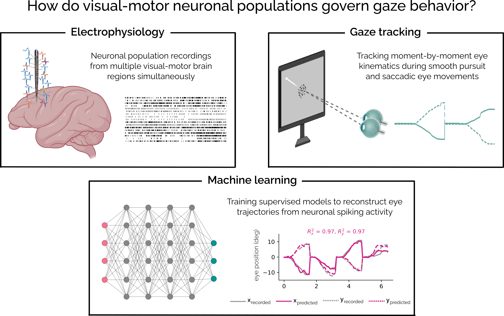

<!-- Header banner -->

  

<!-- Typing tagline -->

  

<!-- Links -->

  
  
  

---

### 🧠 About me

I'm a **postdoctoral researcher** at the **University of Pittsburgh** in the lab of J. Patrick Mayo, with a **Ph.D. in Neural Computation from Carnegie Mellon**. I study how populations of visual-motor neurons give rise to gaze behavior: smooth pursuit, saccades, and everything in between.

- 🔭 **Working on:** decoding eye movements from large-scale neuronal recordings in frontal eye fields
- 🛠️ **Toolkit:** electrophysiology · gaze tracking · machine learning for neural data
- 🤝 **Open to collaborate on:** eye-trace analysis, neural decoding, high-performance computing
- 🔨 **Fun fact:** I competed in the hammer throw in college

### 🔬 Research at a glance

<b>Click to see my research in one picture</b>

 

  

### 🧰 Languages & tools

  

### 📊 GitHub activity

  
  

<!-- Footer wave -->

